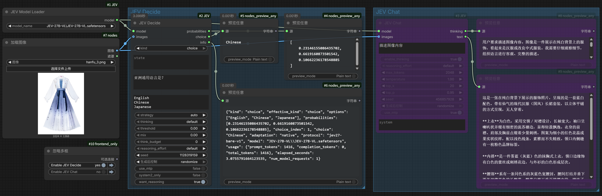

# ComfyUI-JEV（中文）

**JEV-27B-VL**（Qwen3.8-27B-VL 基座 + 决策 LoRA + 决策头）的 ComfyUI 自定义插件，
逐字移植模型包 `serve_decide.py` 的 `jev27-bare-v1` 决策协议。

> 📖 详细操作请见[中文使用说明](使用说明-zh.md)；英文版见 [Usage Guide](Usage.md)。

## Workflow 预览

`JEVModelLoader` 一次加载同时喂两个消费者：`JEVDecide` 对加载的图片跑视觉选项任务（→ `Chinese`，概率 `[0.231, 0.662, 0.107]`，3.1 秒），`JEVChat` 对同一张图片做内容描述，思考通道独立输出。



## 模型文件

模型按 ComfyUI 规范打包为单个 `.safetensors` 放在常规模型目录，同目录附带tokenizer/配置边车文件：

```
models/LLM/JEV-27B-VL/
    JEV-27B-VL.safetensors            合并骨干+视觉+lm_head+MTP（int8 convrot，26.5 GB）
    character_lora_bf16.safetensors   决策 LoRA（401 模块，r32/alpha64）
    decision_head.json                S1 verbalizer id、每类 bias
    calibration.json                  每类 softmax 温度
    adapter_config.json
    tokenizer.json / tokenizer_config.json
    config.json / generation_config.json
    preprocessor_config.json / video_preprocessor_config.json
    chat_template.jinja
```

加载器把 `models/LLM` 注册为名为 `llm` 的新模型目录，因此其中任何 qwen35 风格合并 `.safetensors` 都可选。

### 模型下载

| 来源 | 链接 |
|---|---|
| 魔搭社区（推荐） | <https://modelscope.cn/models/mailzwj/JEV-27B-VL-quant> |
| 夸克网盘 | <https://pan.quark.cn/s/33396d927094> |

下载整个 `JEV-27B-VL` 目录（仅合并单文件为 26.5 GB），放到 `models/LLM/JEV-27B-VL/` 即可。

加载期会把视觉塔 int8 量化的 `pos_embed` 表（约 5 MB）反量化为稠密 bf16 矩阵：服务进程（`NORMAL_VRAM`）下量化-embedding 反量化内核会把 qdata 当 bf16 处理且没有可用后端，不加这一步图像提示词会崩溃。稠密表与内核输出位级一致，使图像路径在所有显存模式下都可用。

## 节点（V3）

| 节点 | 用途 |
|---|---|
| `JEVModelLoader` | 加载合并文本编码器、JEV tokenizer（无 BOS；特殊 token 原子性在加载时断言），并构造 401 个 LoRA bypass hook（尚未注入）。 |
| `JEVDecide` | 运行决策协议：kind `noul` / `score` / `choice`（2–256 选项），可选状态图片，strategy `single` / `permute` / `tournament`（choice >16），自适应 System 2 思考（`default`/`off`/`auto`/`on`、threshold、mix、budget、`reasoning_effort`）。输出：`probabilities`（与选项对齐）、`choice`、`info`（完整协议 JSON）。 |
| `JEVChat` | 基座模型普通对话，官方 Qwen 3.8 chat 模板（思考通道独立输出；`reasoning_effort`、temperature/top_k/top_p、max_tokens、seed、MTP 开关）。 |

自定义连线类型：`JEVMODEL`（模型句柄）、`JEVPROB`（概率列表）。

## 快速上手

1. 重启一次 ComfyUI，使 `JEV` 节点类别出现。
2. 添加 `JEVModelLoader`（下拉默认已选中 `JEV-27B-VL/JEV-27B-VL.safetensors`）。
3. 把它的 `model` 输出接到 `JEVDecide`（设置 `kind`、`question`，choice 再填
   `options`，可选接 `Load Image` 的 `images`）或 `JEVChat`（填 `prompt`）。
4. 排队执行 —— `JEVDecide` 输出概率 / 选择 / 完整协议 JSON，`JEVChat` 分别输出思考通道与回答。

每个参数的默认值与易错点（如 `threshold`/`mix` 填 `0` 表示"用协议默认值"，不是零）见[中文使用说明](使用说明-zh.md)，其中还有 V3 `/prompt` API 约定与最小 JSON 示例。

## 协议语义（与 `serve_decide.py` 对齐）

- **System 1**：对裸帧单次 prefill `[kind] {kind}\n[state] {state}{图片三连}\n[question] {q}\n[options]\n{选项行}\n[decision]:`（无 chat 模板——vLLM 原始路径），然后在末位做一次单 token 读数。决策 LoRA （401 模块含 lm_head，scale alpha/r = 2.0）以 **bypass 手工切换**方式生效：S1 前注入全部 hook，`finally` 中紧随其后卸载，因此 System 2 与 chat 始终跑在未修改的基座模型上。训练的 A–P 决策头标签在加载时与 `decision_head.json` 断言一致。
- **System 2**：基座模型对 `pre + state + {图片三连} + tail + post` 思考（官方 chat 模板、强制开思考、遵守 `reasoning_effort`），在思考收尾 token （id 248069）处停止，然后在 `thought + 收尾 + "\n\nAnswer: ("` 之后一次 prefill 读出答案字母分布。`noul` 翻转回 `[P(false), P(true)]`。种子 = `crc32(question + options)`（节点设了 seed 则用节点值）；采样 temperature 1.0 / top_k 20 / top_p 0.95，与 serve 完全一致。
- **自适应思考**：先 S1；`thinking=on` 或 `auto` 且 max(p1) < threshold （节点 0 = 协议默认 0.8）时计算 p2 并按 `p = (1-w)·p1 + w·p2` 折叠 （节点 mix 0 = 协议默认 0.5）。响应 JSON 与托管 API 同构 （`kind`、`effective_kind`、`options`、`probabilities`、`choice_index`、`choice`、`adaptation`、`protocol`、`model`、`usage`、`elapsed_seconds`、`num_model_requests`、`thinking{mode,threshold,budget,used,think_tokens,think_seconds,finished_within_budget,reasoning}`）。
- **与 serve 一致的默认值**：`strategy auto → single`、`thinking default → off`、`threshold → 0.8`、`mix → 0.5`、`think_budget 0 → 32768`、`seed -1 → crc32 协议种子`。

## MTP

合并 checkpoint 含 MTP 草稿头，ComfyUI 自动检测。`JEVDecide.use_mtp` 默认 **False**：`serve.sh` 跑的是无投机解码的普通 vLLM 解码，决策节点默认与参考服务器一致。`JEVChat.use_mtp` 默认 **True**（自由对话纯为提速）。

`JEVDecide` 与 `JEVChat` 均为输出节点，可直接经 `/prompt` API 提交（无需额外预览节点）。`images` 输入接受 `LoadImage` 节点的张量、ComfyUI input 目录中的文件名字符串、或文件名列表（API 用法：先 `POST /upload/image`，再传返回的 `name`）。

## 验证记录

- `tools/verify_model_dir.py` —— 模型目录完整性；合并文件经 `comfy.sd.load_clip`检测到 `qwen35_27b`（Qwen35、64 层、MTP 开启、int8 convrot 生效）；16 个特殊 token 原子往返；图片三连 = ids [248053, 248056, 248054]；思考收尾 = 248069。
- `tools/smoke_load.py` —— 引擎加载（401 hooks、256 选项标签、256 答案标签、A–P 决策头断言），真实 S1 前向：noul `[0.014, 0.986] → true`、score、 choice `[0.9998, …] → Paris`；S1 跨运行位级确定。
- `tools/validate.py` —— LoRA bypass：注入时读数位移 0.848 → 0.986，卸载后 **位级还原**（残差 0.0）；S2 在协议种子下确定，明显用例答案正确；system2_only 路径；图像路径（smart-resize 单图 prompt tokens 36 → 998）；chat 路径（思考通道拆分、关闭思考保持干净、数学正确）。
- `tools/compare_with_serve.py` —— 用户侧：跑模型包 `serve.sh`（vLLM），把相同用例 POST 到 `/v1/decide`；打印逐选项差值。S1 应到浮点精度一致（差异仅来自 ComfyUI 侧的 int8 convrot 骨干）。S2 有意不比对：两个运行时的采样器即使同种子也逐 token 不同。
- **实机 API（运行中的 ComfyUI，`tools/api_run.py`）** —— 7 个用例全部经 `POST /prompt` 提交并验证：noul `[0.015, 0.985] → true`（7.7 s 含首次权重流式）、score `→ 5`、choice `[0.9998, …] → Paris`（~2 s，热态）、S2 `thinking=on` 正确且 `info` 含推理、adaptive `auto`/阈值 0.9 触发 System 2（S1 最大 0.856 < 0.9，折入 p2）、chat 思考开/关通道拆分、image（上传 1 图 → 999 prompt tokens，`[0.24, 0.76] → true`）。

## 内存

文本编码器 int8 共约 26.5 GB（骨干 26.1 GB + 视觉 0.4 GB）。MinVram hook 模式下，权重按前向从系统内存流式进入显存；预计系统内存常驻约 28 GB，显存峰值约 15–25 GB（32 GB 卡舒适；更小的卡可用但 fault-in 较慢）。适配权重（bf16，~0.4 GB）仅在 S1 hooks 注入期间上卡。

## 环境要求

ComfyUI ≥ 0.45（原生 `qwen35_27b` 文本编码器），Python 依赖用标准 ComfyUI 环境即可（torch、transformers、safetensors）。不新增任何第三方依赖。
