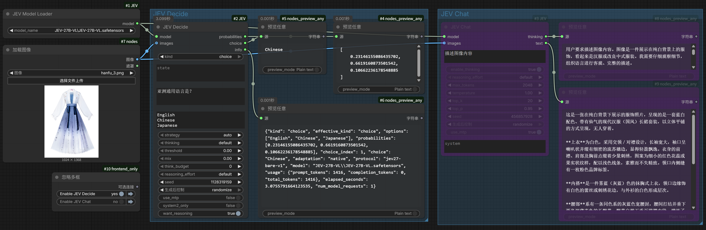

# ComfyUI-JEV

ComfyUI custom plugin for **JEV-27B-VL** (Qwen3.8-27B-VL backbone + decision LoRA + decision head),
implementing the `jev27-bare-v1` decision protocol from the model's `serve_decide.py`.

> 📖 Step-by-step how to use the nodes (installation, every parameter, API calling, FAQ):
> see the [English Usage Guide](Usage.md). 中文：[README-zh](README-zh.md) / [中文使用说明](使用说明-zh.md).

## Workflow preview

`JEVModelLoader` feeds both consumers from a single load: `JEVDecide` runs a
vision choice task on the loaded image (→ `Chinese`, probabilities
`[0.231, 0.662, 0.107]` in 3.1 s), while `JEVChat` describes the same image
with the thinking channel split into its own preview.



## Model files

The model is packaged per ComfyUI convention as a single `.safetensors` in the normal model
folders, plus the tokenizer/config sidecars in the same directory:

```
models/LLM/JEV-27B-VL/
    JEV-27B-VL.safetensors        merged backbone + vision + lm_head + MTP (int8 convrot, 26.5 GB)
    character_lora_bf16.safetensors  decision LoRA (401 modules, r32/alpha64)
    decision_head.json             S1 verbalizer ids, per-kind bias
    calibration.json               per-kind softmax temperatures
    adapter_config.json
    tokenizer.json / tokenizer_config.json
    config.json / generation_config.json
    preprocessor_config.json / video_preprocessor_config.json
    chat_template.jinja
```

The loader registers `models/LLM` as a new model folder named `llm`, so any merged
qwen35-style `.safetensors` dropped there is selectable.

### Downloading the model

| Source | Link |
|---|---|
| ModelScope (recommended) | <https://modelscope.cn/models/mailzwj/JEV-27B-VL-quant> |
| Quark netdisk | <https://pan.quark.cn/s/33396d927094> |

Download the whole `JEV-27B-VL` directory (≈ 53 GB with the two pre-merge shards kept;
the merged single file alone is 26.5 GB) and place it at `models/LLM/JEV-27B-VL/`.

At load time the vision tower's int8-quantized `pos_embed` table (~5 MB) is dequantized to a
dense bf16 matrix: in service mode (`NORMAL_VRAM`) the quantized-embedding dequant kernel finds
the qdata as bf16 and has no capable backend, so image prompts crash without this. The dense
table is bit-identical to the kernel output and makes the image path work in every VRAM mode.

## Nodes (V3)

| Node | Purpose |
|---|---|
| `JEVModelLoader` | Loads the merged text encoder, the JEV tokenizer (no BOS; atomic special tokens verified at load), and builds the 401 LoRA bypass hooks (not injected yet). |
| `JEVDecide` | Runs the decision protocol: kind `noul` / `score` / `choice` (2–256 options), optional state images, strategy `single` / `permute` / `tournament` (choices >16), adaptive System 2 thinking (`default`/`off`/`auto`/`on`, threshold, mix, budget, `reasoning_effort`). Outputs: `probabilities` (aligned with the options), `choice`, `info` (full protocol JSON). |
| `JEVChat` | Plain chat through the base model with the official Qwen 3.8 chat template (thinking channel split into a separate output; `reasoning_effort`, temperature/top_k/top_p, max_tokens, seed, MTP toggle). |

Custom link types: `JEVMODEL` (model handle), `JEVPROB` (probability list).

## Quick start

1. Restart ComfyUI once so the `JEV` node category appears.
2. Add a `JEVModelLoader` (combo pre-selects `JEV-27B-VL/JEV-27B-VL.safetensors`).
3. Wire its `model` into `JEVDecide` (set `kind`, `question`, `options` for choice,
   optionally `images` from a `Load Image` node) or `JEVChat` (set `prompt`).
4. Queue the prompt — `JEVDecide` prints probabilities / choice / the full protocol JSON,
   `JEVChat` prints the thinking channel and the answer separately.

Every parameter with its default and gotcha (e.g. `threshold`/`mix` of `0` means
"protocol default", not zero) is documented in the [Usage Guide](Usage.md),
together with the V3 `/prompt` API conventions and a minimal JSON example.

## Protocol semantics (parity with `serve_decide.py`)

- **System 1**: one prefill over the bare frame
  `[kind] {kind}\n[state] {state}{image triples}\n[question] {q}\n[options]\n{lines}\n[decision]:`
  (no chat template — the vLLM raw path), then a one-token readout at the last position.
  The decision LoRA (401 modules incl. lm_head, scale alpha/r = 2.0) is applied **bypass-style
  with manual toggle**: all hooks are injected right before the S1 pass and ejected in `finally`
  right after it, so System 2 and chat always run on the unmodified base model. The trained
  A–P head labels are asserted against `decision_head.json` at load.
- **System 2**: the base model thinks over `pre + state + {image triples} + tail + post`
  (official chat template, thinking forced on, `reasoning_effort` honored), stops at the
  think-close token (id 248069), and the answer-letter distribution is read in one prefill
  after `thought + think-close + "\n\nAnswer: ("`. `noul` flips to `[P(false), P(true)]`.
  Seed = `crc32(question + options)` unless the node seed is set; sampling is temperature 1.0 /
  top_k 20 / top_p 0.95, exactly as serve.
- **Adaptive thinking**: S1 first; when `thinking=on` or `auto` with max(p1) < threshold
  (node 0 = protocol default 0.8), p2 is computed and folded `p = (1-w)·p1 + w·p2`
  (node mix 0 = protocol default 0.5). Response JSON mirrors the hosted API
  (`kind`, `effective_kind`, `options`, `probabilities`, `choice_index`, `choice`,
  `adaptation`, `protocol`, `model`, `usage`, `elapsed_seconds`, `num_model_requests`,
  `thinking{mode,threshold,budget,used,think_tokens,think_seconds,finished_within_budget,reasoning}`).
- **Defaults matching serve**: `strategy auto → single`, `thinking default → off`,
  `threshold → 0.8`, `mix → 0.5`, `think_budget 0 → 32768`, `seed -1 → crc32 protocol seed`.

## MTP

The merged checkpoint contains the MTP draft head and ComfyUI auto-detects it.
`JEVDecide.use_mtp` defaults to **False**: `serve.sh` runs plain vLLM decode without
speculative decoding, so the decision node matches the reference server by default.
`JEVChat.use_mtp` defaults to **True** (pure speed for free-form chat).

`JEVDecide` and `JEVChat` are output nodes, so they can be submitted through the `/prompt`
API directly (no extra preview node needed). The `images` input accepts a tensor from a
`LoadImage` node, a string filename from the ComfyUI input directory, or a list of filenames
(API usage: `POST /upload/image` first, then pass the returned `name`).

## Verification performed

- `tools/verify_model_dir.py` — model dir completeness; `comfy.sd.load_clip` of the merged file
  detects `qwen35_27b` (Qwen35, 64 layers, MTP on, int8 convrot active); 16 atomic special
  tokens round-trip; image triple = ids [248053, 248056, 248054]; think-close = 248069.
- `tools/smoke_load.py` — engine load (401 hooks, 256 choice labels, 256 answer labels, A–P head
  assert), real S1 forwards: noul `[0.014, 0.986] → true`, score, choice `[0.9998, …] → Paris`;
  S1 bit-deterministic across runs.
- `tools/validate.py` — LoRA bypass: readout shifts 0.848 → 0.986 with hooks and restores
  **bit-exactly** after eject (residual 0.0); S2 deterministic under the protocol seed, correct
  answers on obvious cases; system2_only path; image path (prompt tokens 36 → 998 for one
  smart-resized image); chat path (thinking channel split, thinking-off stays clean, math correct).
- `tools/compare_with_serve.py` — user-side: run the model package's `serve.sh` (vLLM) and POST
  the same cases to `/v1/decide`; prints per-option deltas. S1 should agree to float precision
  (differences only from int8 convrot backbone on the ComfyUI side). S2 is intentionally not
  compared: the two runtimes' samplers diverge token-for-token even with equal seeds.
- **Live API (running ComfyUI, `tools/api_run.py`)** — all 7 cases submitted through `POST
  /prompt` and verified: noul `[0.015, 0.985] → true` (7.7 s incl. first weight stream), score
  `→ 5`, choice `[0.9998, …] → Paris` (~2 s, warm), S2 `thinking=on` correct with reasoning in
  `info`, adaptive `auto`/threshold 0.9 triggered System 2 (S1 max 0.856 < 0.9, folded p2 in),
  chat thinking on/off channel split, and image (1 uploaded image → 999 prompt tokens,
  `[0.24, 0.76] → true`).

## Memory

The text encoder is ~26.5 GB in int8 (backbone 26.1 GB + vision 0.4 GB). With the MinVram hook
mode, weights stream from system RAM into VRAM per forward; expect ~28 GB of system RAM in use
and roughly 15–25 GB VRAM peaks (a 32 GB card is comfortable; on tighter cards expect slow
fault-in). Adapter weights (bf16, ~0.4 GB) move to the GPU only while the S1 hooks are injected.

## Requirements

ComfyUI ≥ 0.45 (native `qwen35_27b` text encoder), Python deps already in a standard ComfyUI
env (torch, transformers, safetensors). No new third-party dependencies are added.
